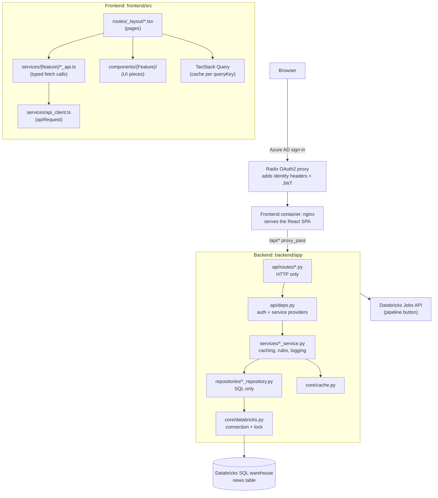
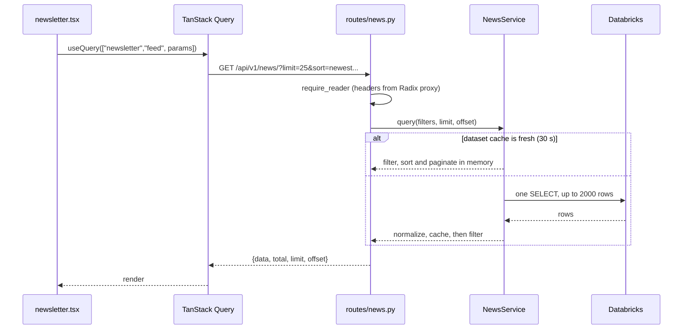
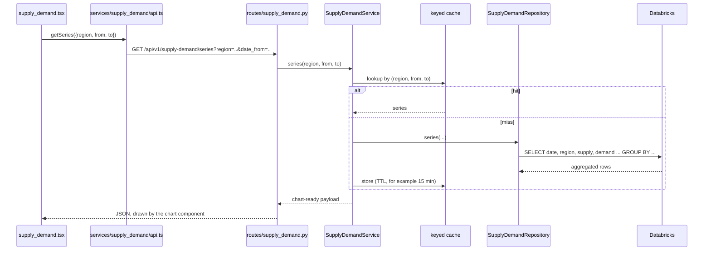

# LNG Trading App — News Analytics for LNG Markets

LNG news curation and sentiment analytics dashboard. Built with React + TypeScript (frontend) and FastAPI + Python (backend), backed by Databricks SQL and deployed on Radix.

## Prerequisites

- Docker Desktop (includes Docker Compose)
- Access to the Databricks workspace `gplng-plab-dbw` to retrieve the service principal credentials

## Running Locally

### 1. Configure environment variables

Copy the example env file at the repository root:

```bash
cp .env.example .env
```

Open `.env` and configure the Databricks connection:

```dotenv
# Databricks SQL Warehouse connection
DATABRICKS_SERVER_HOSTNAME=adb-XXXX.7.azuredatabricks.net
DATABRICKS_HTTP_PATH=/sql/1.0/warehouses/<warehouse-id>

# Service Principal auth
DATABRICKS_USE_SERVICE_PRINCIPAL=true
DATABRICKS_TENANT_ID=<tenant-id>
DATABRICKS_CLIENT_ID=<client-id>
DATABRICKS_CLIENT_SECRET=<client-secret>
DATABRICKS_WORKSPACE_RESOURCE_ID=<full-resource-id>
```

### 2. Start all services

From the repository root:

```bash
docker compose watch
```

This starts the following containers:

| Container | Exposed at |
|-----------|-----------|
| frontend (React + Vite + nginx) | http://localhost:5173 |
| backend (FastAPI) | http://localhost:8000 |
| db (PostgreSQL) | localhost:5432 |
| adminer (DB admin UI) | http://localhost:8080 |
| mailcatcher (local email) | http://localhost:1080 |

### 3. Open the app

http://localhost:5173

### Subsequent starts

Once the images are built, a plain `docker compose watch` will pick up file changes automatically via Docker watch mode (hot-reload for both frontend and backend).

To restart without watch mode:

```bash
docker compose up
```

### Tear down

```bash
docker compose down
```

To also remove the named volumes (database data):

```bash
docker compose down -v
```

## Local Development (without Docker)

You can stop individual Docker services and run them locally instead:

**Frontend:**
```bash
docker compose stop frontend
cd frontend
bun install
bun run dev
```

**Backend:**
```bash
docker compose stop backend
cd backend
fastapi dev app/main.py
```

Both use the same ports as their Docker counterparts, so everything keeps working seamlessly.

## Architecture



Each layer has one job:

| Layer | Responsibility |
|-------|----------------|
| `api/routes` | Parse request parameters, call a service, return the response. No business logic. |
| `api/deps.py` | Authentication and authorization (Reader / Writer roles) and service providers for dependency injection. |
| `services` | Business rules, caching, normalization, logging. |
| `repositories` | SQL only. Returns raw rows. |
| `core` | Configuration, the Databricks connection, caches. |

There is no mock backend. The backend always talks to Databricks, so a valid Databricks configuration is required to run it.

### How a frontend page reaches a backend route

The two sets of routes are connected only by the URL path `/api/...`.

| Kind | Defined in | Example |
|------|------------|---------|
| Page route | `frontend/src/routes/_layout/*.tsx` (TanStack Router) | `/newsletter` |
| API route | `backend/app/api/routes/*.py` (FastAPI) | `GET /api/v1/news/` |

The backend URL is assembled from three prefixes: `/api/v1` (`API_V1_STR` in `core/config.py`, used in `main.py`), `/news` (set in `api/main.py`), and the route decorator in the route file. The frontend repeats the full path by hand in `services/news/news_api.ts`, so a prefix change on the backend must be changed there too.

Requests are forwarded to the backend as follows:

| Environment | What forwards `/api` |
|-------------|----------------------|
| Radix (dev / prod) | nginx in the frontend container (`frontend/nginx-backend-not-found.conf`, `proxy_pass http://backend:8000`) |
| `bun run dev` | Vite dev proxy (`frontend/vite.config.ts`, target `http://localhost:8000`) |

The browser only talks to one origin, so no CORS is involved. nginx also forwards the `X-Auth-Request-*` and `Authorization` headers that the Radix OAuth2 proxy adds. `get_current_user` in `api/deps.py` reads them. When no proxy is in front of the backend (local development), it falls back to a dev user (`analyst@example.com`) with full access, so `/api/v1/utils/me` returns that user locally.

### Data flow: reading



Filtering, sorting and pagination run in memory against one cached snapshot, so Databricks is queried at most once per 30-second window.

### Data flow: writing (favourite, read, sentiment, classification)

1. The page calls `PATCH /news/{id}/favourite` (or `/read`, `/sentiment`, `/classification`). This needs the Writer role.
2. `NewsService.begin_update` stores an optimistic override and the route returns it at once.
3. A background task runs `NewsService.commit_update`, which sends the UPDATE to Databricks. On success it patches the cached dataset and clears the override. On failure it logs the error (with the user's email), clears the override and invalidates the cache.
4. The page invalidates its query and refetches.

Write failures are only logged. They are not shown in the UI.

### Other endpoints

- `GET /news/facets`: distinct categories and regions for the filter dropdowns.
- `POST /news/email-summary`: builds an email from the favourited articles (`services/email_service.py`) and sends it in the background. Needs the Writer role and the Atlas email settings.
- `GET /news/pipeline/last-run` and `POST /news/pipeline/trigger`: read the status of, and start, the Databricks ingestion job through the Jobs REST API (`services/databricks_jobs.py`). Trigger returns 503 when Databricks is not configured.

## Adding a New Page

Each page is its own vertical slice: a route, a service and a repository on the backend, and a page, an API module and components on the frontend. Slices share only auth, the Databricks connection and the cache.

The example below is a supply and demand charts page.

### Where each file goes

```
backend/app/
  repositories/supply_demand_repository.py   SQL only
  services/supply_demand_service.py          caching and shaping the data
  schemas/supply_demand.py                   response models
  api/routes/supply_demand.py                HTTP endpoints
  api/deps.py                                add a service provider
  api/main.py                                register the router

frontend/src/
  services/supply_demand/api.ts              typed calls to the backend
  routes/_layout/supply_demand.tsx           the page
  components/SupplyDemand/*.tsx              chart and filter components
  components/Sidebar/AppSidebar.tsx          add a menu entry
```

### Data flow for the new page



### Backend steps

1. **Repository** (`repositories/supply_demand_repository.py`): SQL only, using `?` placeholders.
   ```python
   class SupplyDemandRepository:
       def series(self, region: str | None, date_from: str, date_to: str) -> list[dict]:
           query = f"""
               SELECT date, region, SUM(supply) AS supply, SUM(demand) AS demand
               FROM {settings.SUPPLY_DEMAND_TABLE}
               WHERE (? IS NULL OR region = ?) AND date BETWEEN ? AND ?
               GROUP BY date, region ORDER BY date
           """
           return fetch_all(query, [region, region, date_from, date_to])
   ```
   Add `SUPPLY_DEMAND_TABLE` to `core/config.py`, and to the variables in `radixconfig.yaml`.
2. **Service**: holds the repository, caches results and returns chart-ready series. `TTLCache` in `core/cache.py` holds a single value, so parametrised data needs a keyed cache. Add a `KeyedTTLCache` next to it.
3. **Provider** in `api/deps.py`, the same pattern as news:
   ```python
   @lru_cache
   def get_supply_demand_service() -> SupplyDemandService:
       return SupplyDemandService(SupplyDemandRepository())

   SupplyDemandServiceDep = Annotated[SupplyDemandService, Depends(get_supply_demand_service)]
   ```
4. **Route** (`api/routes/supply_demand.py`), with the Reader role applied to the whole router:
   ```python
   router = APIRouter(dependencies=[Depends(require_reader)])

   @router.get("/series", response_model=SeriesResponse)
   def series(service: SupplyDemandServiceDep, date_from: str, date_to: str, region: str | None = None):
       return service.series(region, date_from, date_to)
   ```
   For write endpoints, add a `WriterUser` parameter.
5. **Register it** in `api/main.py`:
   ```python
   api_router.include_router(supply_demand.router, prefix="/supply-demand", tags=["supply-demand"])
   ```
   The tag is required, because `custom_generate_unique_id` in `main.py` reads `route.tags[0]`.

### Frontend steps

1. **API module** (`services/supply_demand/api.ts`):
   ```ts
   export const getSeries = (p: { region?: string; dateFrom: string; dateTo: string }) =>
     apiRequest<SeriesResponse>("/api/v1/supply-demand/series", {
       query: { date_from: p.dateFrom, date_to: p.dateTo, ...(p.region ? { region: p.region } : {}) },
     })
   ```
   All `query` values must be strings.
2. **Page** (`routes/_layout/supply_demand.tsx`): the file path decides the URL, so this page is `/supply_demand`.
   ```tsx
   export const Route = createFileRoute("/_layout/supply_demand")({ component: SupplyDemand })

   function SupplyDemand() {
     const q = useQuery({
       queryKey: ["supply_demand", "series", params],
       queryFn: () => getSeries(params),
       staleTime: 5 * 60_000,
     })
     // render the filters and <SupplyDemandChart data={q.data} />
   }
   ```
3. **Sidebar entry**: add an item to `baseItems` in `components/Sidebar/AppSidebar.tsx`, for example `{ icon: LineChart, title: "Supply & Demand", path: "/supply_demand" }`.
4. **Chart library**: none is installed yet. Add one in `frontend/`, for example `bun add recharts`.
5. **Route tree**: `frontend/src/routeTree.gen.ts` is regenerated by the Vite router plugin when you run `bun run dev` or `bun run build`. Do not edit it by hand.

### What you do not need to change

- **nginx and the Vite dev proxy**: every `/api/...` path is already forwarded.
- **Auth**: the `_layout` shell and the router-level `require_reader` cover it.
- **Query client setup and the 401/403 redirect**: both are global in `main.tsx`.

### Things to watch

- **One Databricks connection**: `core/databricks.py` holds one connection behind one lock, so a slow query on one page blocks the others. Cache results, and move to a small connection pool when several heavy pages exist.
- **Aggregate in SQL**: do not copy the news pattern of loading rows and filtering in Python for time series. Return only the series the chart needs.
- **Per-process caches**: caches are not shared between workers or replicas, so each keeps its own copy.
- **Tests**: a service can be tested without a database by overriding its provider, for example `app.dependency_overrides[get_supply_demand_service]`.

## Project Structure

```
lng-trading-app/
├── backend/                    # FastAPI application
│   ├── app/
│   │   ├── main.py             # Entry point, middleware, router registration
│   │   ├── api/
│   │   │   ├── deps.py          # Auth (roles) and service providers (dependency injection)
│   │   │   └── routes/          # Thin HTTP endpoints: news, pipeline, utils
│   │   ├── services/           # Business logic
│   │   │   ├── news_service.py           # Dataset cache, optimistic updates, background writes
│   │   │   ├── news_query.py             # Filtering, sorting, pagination
│   │   │   ├── email_service.py          # Summary email builder
│   │   │   ├── databricks_jobs.py        # Pipeline trigger / status (Jobs REST API)
│   │   │   └── normalization.py          # Shared data normalization utilities
│   │   ├── repositories/
│   │   │   └── news_repository.py        # SQL access to the news table
│   │   ├── core/
│   │   │   ├── config.py        # All configuration (loaded from .env)
│   │   │   ├── cache.py         # TTLCache and PendingOverrides
│   │   │   ├── databricks.py    # Databricks connection manager
│   │   │   └── security.py     # JWT / password hashing
│   │   └── schemas/            # Pydantic request/response models
│   ├── tests/                  # Pytest test suite
│   └── Dockerfile
├── frontend/                   # React + TypeScript application
│   ├── src/
│   │   ├── main.tsx            # App entry point
│   │   ├── routes/             # TanStack Router file-based routes
│   │   │   └── _layout/
│   │   │       ├── newsletter.tsx      # Main news feed with analyst controls
│   │   │       └── news_summary.tsx    # Favourited news summary dashboard
│   │   ├── components/         # UI components (shadcn/ui based)
│   │   ├── services/           # API client and news service modules
│   │   │   └── news/
│   │   │       ├── news_api.ts   # API functions (getNews, patch*)
│   │   │       └── news_utils.ts # Shared helpers (formatTime, cleanTagValue, etc.)
│   │   └── lib/utils.ts        # Tailwind merge + formatHtmlText
│   ├── nginx.conf              # Production nginx config
│   └── Dockerfile
├── compose.yml                 # Base Docker Compose config
├── compose.override.yml        # Local dev overrides (ports, hot-reload, mailcatcher)
├── compose.traefik.yml         # Traefik proxy config for subdomain routing
├── radixconfig.yaml            # Radix (Equinor PaaS) deployment config
└── .env                        # ⚠ Local secrets — gitignored, never commit
```

## Environment Variables Reference

### Required locally

| Variable | Description |
|----------|-------------|
| `DATABRICKS_SERVER_HOSTNAME` | Databricks workspace hostname |
| `DATABRICKS_HTTP_PATH` | SQL Warehouse HTTP path |
| `DATABRICKS_USE_SERVICE_PRINCIPAL` | Set to `true` |
| `DATABRICKS_TENANT_ID` | Azure AD tenant ID |
| `DATABRICKS_CLIENT_ID` | Service principal client ID |
| `DATABRICKS_CLIENT_SECRET` | Service principal client secret |
| `DATABRICKS_WORKSPACE_RESOURCE_ID` | Full Azure resource ID for the workspace |

### Optional / pre-filled

| Variable | Default | Description |
|----------|---------|-------------|
| `NEWS_TABLE` | `ms_vulcan_gplng_plab.trader_news_app.platts_lng_top_news` | Unity Catalog table name |
| `SECRET_KEY` | random | JWT signing key |
| `BACKEND_CORS_ORIGINS` | `http://localhost:5173` | Allowed CORS origins |
| `FIRST_SUPERUSER` | `admin@example.com` | Default admin user email |
| `FIRST_SUPERUSER_PASSWORD` | `changethis` | Default admin password |

### Not needed locally

| Variable | Why not needed |
|----------|---------------|
| `SENTRY_DSN` | Error tracking — only for staging/production |
| `SMTP_HOST` / `SMTP_USER` / `SMTP_PASSWORD` | Mailcatcher handles email locally |

## Deployment

The app deploys on [Radix](https://www.radix.equinor.com/) (Equinor's PaaS). Configuration is in `radixconfig.yaml`.

| Environment | Branch | Frontend |
|-------------|--------|----------|
| dev | `main` | Auth bypassed (`VITE_BYPASS_AUTH=true`) |
| prod | `release` | Full auth enabled |

The backend reads its Databricks credentials from Radix secrets.

## Tech Stack

- **Frontend:** React 19, TypeScript, Vite, TanStack Router, TanStack React Query, Tailwind CSS v4, shadcn/ui
- **Backend:** FastAPI, Python 3.12+, Pydantic, Databricks SQL Connector
- **Database:** PostgreSQL (user accounts), Databricks Unity Catalog (news data)
- **Infrastructure:** Docker Compose (local), Radix (deployment), Traefik (proxy)
- **Testing:** Pytest (backend), Playwright (E2E)
