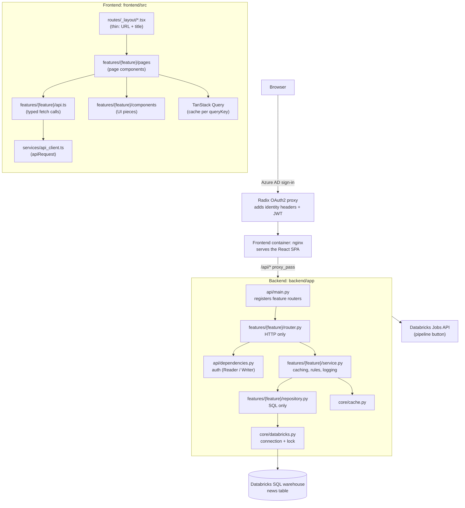
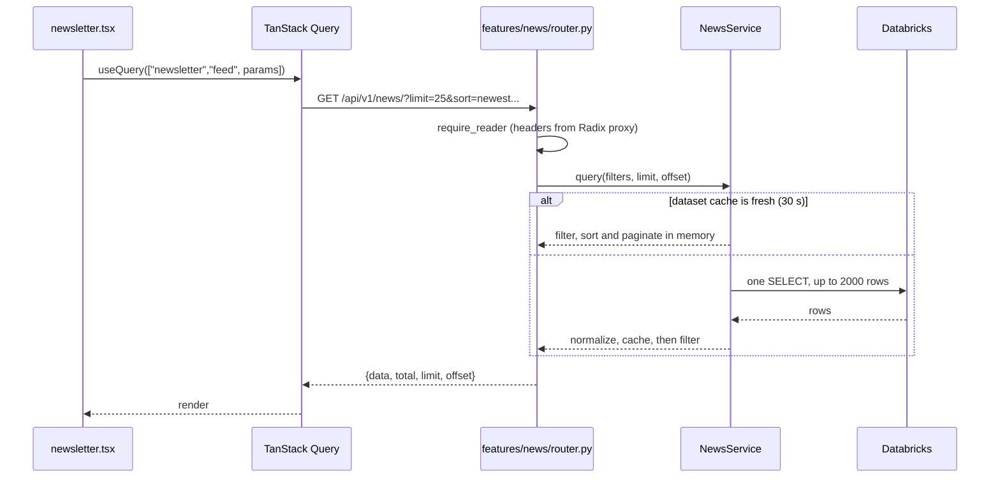
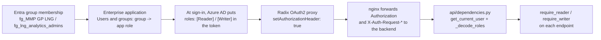
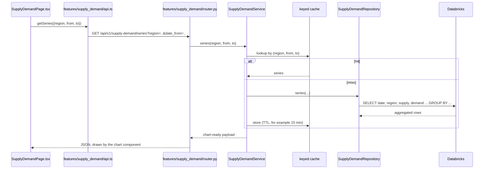

# LNG Trading App — News Analytics for LNG Markets

LNG news curation and sentiment analytics dashboard. Built with React + TypeScript (frontend) and FastAPI + Python (backend), backed by Databricks SQL and deployed on Radix.

## Prerequisites

- Docker Desktop (includes Docker Compose)
- Access to the Databricks workspace `gplng-plab-dbw` to retrieve the service principal credentials

## Running Locally

### 1. Configure environment variables

Copy the example env file at the repository root:

```bash
cp .env.example .env
```

Open `.env` and configure the Databricks connection:

```dotenv
# Databricks SQL Warehouse connection
DATABRICKS_SERVER_HOSTNAME=adb-XXXX.7.azuredatabricks.net
DATABRICKS_HTTP_PATH=/sql/1.0/warehouses/<warehouse-id>

# Service Principal auth
DATABRICKS_USE_SERVICE_PRINCIPAL=true
DATABRICKS_TENANT_ID=<tenant-id>
DATABRICKS_CLIENT_ID=<client-id>
DATABRICKS_CLIENT_SECRET=<client-secret>
DATABRICKS_WORKSPACE_RESOURCE_ID=<full-resource-id>
```

### 2. Start all services

From the repository root:

```bash
docker compose watch
```

This starts the following containers:

| Container | Exposed at |
|-----------|-----------|
| frontend (React + Vite + nginx) | http://localhost:5173 |
| backend (FastAPI) | http://localhost:8000 |
| db (PostgreSQL) | localhost:5432 |
| adminer (DB admin UI) | http://localhost:8080 |
| mailcatcher (local email) | http://localhost:1080 |

### 3. Open the app

http://localhost:5173

### Subsequent starts

Once the images are built, a plain `docker compose watch` will pick up file changes automatically via Docker watch mode (hot-reload for both frontend and backend).

To restart without watch mode:

```bash
docker compose up
```

### Tear down

```bash
docker compose down
```

To also remove the named volumes (database data):

```bash
docker compose down -v
```

## Local Development (without Docker)

You can stop individual Docker services and run them locally instead:

**Frontend:**
```bash
docker compose stop frontend
cd frontend
bun install
bun run dev
```

**Backend:**
```bash
docker compose stop backend
cd backend
fastapi dev app/main.py
```

Both use the same ports as their Docker counterparts, so everything keeps working seamlessly.

## Architecture



Each page is a feature: a folder under `backend/app/features/` (`news`, `pipeline_nominations`, `lng_balance`, `pipeline`, `mid_term_curves`) and one under `frontend/src/features/`. Each layer has one job:

| Layer | Responsibility |
|-------|----------------|
| `features/{feature}/router.py` | Parse request parameters, call the service, return the response. No business logic. |
| `features/{feature}/dependencies.py` | Builds the feature's service for dependency injection (one instance per process). |
| `features/{feature}/service.py` | Business rules, caching, normalization, logging. |
| `features/{feature}/repository.py` | SQL only. Returns raw rows. |
| `api/dependencies.py` | Authentication and authorization (Reader / Writer roles), shared by every feature. |
| `api/main.py` | Registers every feature router under `/api/v1`. |
| `core` | Configuration, the Databricks connection, caches. |

Calls only go one way: router, service, repository, core. Features do not import from each other. Anything two features need goes in `core` (backend) or in the shared folders `components`, `hooks` and `lib` (frontend).

There is no mock backend. The backend always talks to Databricks, so a valid Databricks configuration is required to run it.

### How a frontend page reaches a backend route

The two sets of routes are connected only by the URL path `/api/...`.

| Kind | Defined in | Example |
|------|------------|---------|
| Page route | `frontend/src/routes/_layout/*.tsx` (TanStack Router): URL and title only, the page lives in `frontend/src/features/*/pages/` | `/newsletter` |
| API route | `backend/app/features/*/router.py` (FastAPI) | `GET /api/v1/news/` |

The backend URL is assembled from three prefixes: `/api/v1` (`API_V1_STR` in `core/config.py`, used in `main.py`), `/news` (set in `api/main.py`), and the route decorator in the feature's router. The frontend repeats the full path by hand in `features/news/api.ts`, so a prefix change on the backend must be changed there too.

Requests are forwarded to the backend as follows:

| Environment | What forwards `/api` |
|-------------|----------------------|
| Radix (dev / prod) | nginx in the frontend container (`frontend/nginx-backend-not-found.conf`, `proxy_pass http://backend:8000`) |
| `bun run dev` | Vite dev proxy (`frontend/vite.config.ts`, target `http://localhost:8000`) |

The browser only talks to one origin, so no CORS is involved. nginx also forwards the `X-Auth-Request-*` and `Authorization` headers that the Radix OAuth2 proxy adds. `get_current_user` in `api/dependencies.py` reads them. When no proxy is in front of the backend (local development), it falls back to a dev user (`analyst@example.com`) with full access, so `/api/v1/utils/me` returns that user locally.

### Data flow: reading



Filtering, sorting and pagination run in memory against one cached snapshot, so Databricks is queried at most once per 30-second window.

### Data flow: writing (favourite, read, sentiment, classification)

1. The page calls `PATCH /news/{id}/favourite` (or `/read`, `/sentiment`, `/classification`). This needs the Writer role.
2. `NewsService.begin_update` stores an optimistic override and the route returns it at once.
3. A background task runs `NewsService.commit_update`, which sends the UPDATE to Databricks. On success it patches the cached dataset and clears the override. On failure it logs the error (with the user's email), clears the override and invalidates the cache.
4. The page invalidates its query and refetches.

Write failures are only logged. They are not shown in the UI.

### Other endpoints

- `GET /news/facets`: distinct categories and regions for the filter dropdowns.
- `GET /pipeline-nominations/filters` and `GET /pipeline-nominations/overview`: data for the Pipeline Nominations page (see below).
- `POST /news/email-summary`: builds an email from the favourited articles (`features/news/email_summary.py`) and sends it in the background. Needs the Writer role and the Atlas email settings.
- `GET /news/pipeline/last-run` and `POST /news/pipeline/trigger`: read the status of, and start, the Databricks ingestion job through the Jobs REST API (`features/pipeline/jobs.py`). Trigger returns 503 when Databricks is not configured.

## Pipeline Nominations page

The page at `/pipeline_nominations` shows US LNG feedgas pipeline nominations per plant, pipeline and day, with by-cycle detail. WoodMac Genscape supplies most plants and Platts supplies LNG Canada and Costa Azul, both read through one gold table. It is a feature folder on each side, as described under "Adding a New Page".

| Part | File |
|------|------|
| Route (HTTP only) | `backend/app/features/pipeline_nominations/router.py` |
| Service (cache, daily series, monthly and daily tables, % change, AI overview call) | `backend/app/features/pipeline_nominations/service.py` |
| AI overview prompt (digest of the overview tables) | `backend/app/features/pipeline_nominations/ai_overview.py` |
| Repository (one SQL query per source, plus one for the WoodMac cycle view) | `backend/app/features/pipeline_nominations/repository.py` |
| Response models | `backend/app/features/pipeline_nominations/schemas.py` |
| Service provider | `backend/app/features/pipeline_nominations/dependencies.py` |
| API calls and types | `frontend/src/features/pipeline_nominations/api.ts` |
| Page | `frontend/src/features/pipeline_nominations/pages/PipelineNominationsPage.tsx` |
| Route (URL and title) | `frontend/src/routes/_layout/pipeline_nominations.tsx` |
| Components | `frontend/src/features/pipeline_nominations/components/` (`PipelineFilter`, `FlowChart`, `CycleChart`, `NominationsMatrix`) |

**Data.** One gold table, `PIPELINE_NOMINATIONS_GOLD_TABLE`. The service account used by the backend needs `SELECT` on it.

| Setting | Default table | Volume column |
|---------|---------------|---------------|
| `PIPELINE_NOMINATIONS_GOLD_TABLE` | `ms_vulcan_gplng_plab.fundamentals_gold.us_lng_feedgas_tracking` | `vol_bcfd`, per `plant` (facility), `pipeline_name`, `gas_day`, with `cycle`, `revision_no` and the `is_latest_*` flags |

The daily query returns one row per facility, pipeline and day (BCF) over the last 12 months. The gold table has one row per meter, gas day, cycle and revision, so the daily query keeps only `is_latest_for_day` rows (summing without that filter would count a day once per cycle). The gold table covers a rolling 12 months, so the page starts at the first whole month. It takes Platts for LNG Canada and Costa Azul and WoodMac for every other plant. The service caches the daily data for 15 minutes and derives everything else from it in memory. The cycle view reads its own gold query (the last 14 gas days), cached for one hour.

**Endpoints** (Reader role):

| Endpoint | Returns |
|----------|---------|
| `GET /api/v1/pipeline-nominations/filters` | Facilities with their pipelines, and the latest data date |
| `GET /api/v1/pipeline-nominations/overview?selected=Facility::Pipeline\|Facility::Pipeline` | The 14-day and 180-day daily series per facility, plus two tables with the same shape: `monthly_table` (one column per month) and `daily_table` (one column per day for the last 14 days), and `cycle_series` (the final nomination of each cycle for the last 7 gas days, per facility) and `cycle_table` (the last 3 gas days, one column per cycle). An empty `selected` means everything. |
| `POST /api/v1/pipeline-nominations/ai-overview?selected=...&refresh=true` | A written summary (`text`, `model`, `latest_date`, `generated_at`) of the same view and filters. Cached for an hour per filter and latest date; `refresh=true` skips the cache. |

**Behaviour to know about**

- The 14 and 180 day windows end at the latest date in the data, not at today's date, so the charts are never empty when the feed is a few days behind. They share one **Flow BCF/d** chart with a 14 days / 180 days switch, newest day on the right. In both charts the latest value is written at the tail end of each line (labels that would overlap are spread apart, see `EndLabels.tsx`), and the legend sits below the chart.
- The WoodMac cycle chart sits beside the flow chart. It shows one gas day at a time (a switch picks one of the last 5), with the cycles on the x axis and a line per facility, so every plant is visible and nothing is summed. A line only joins the cycles of its own day, because each point is that cycle's final nomination, not a value that holds over time. Every plant has cycle data, including LNG Canada and Costa Azul.
- **AI overview.** A card at the top of the page shows a summary of the current view from a Databricks Foundation Model endpoint. The backend (`ai_overview.py`) turns the overview tables into a short text digest (daily totals, facility and pipeline moves, monthly averages and, for WoodMac, the latest day's cycle revisions) and sends it with `ai_query` over the existing SQL connection, so no extra credentials are needed. The model is told to use only that digest. Nothing is generated on the server until the page asks: the summary is requested when the page loads and again, about a second after you stop changing them, when the source or filter changes. A **Regenerate** button skips the server cache. The endpoint comes from `PIPELINE_NOMINATIONS_AI_ENDPOINT`.
- The page shows the table first and the charts below it.
- Month columns come from the whole dataset, so they stay the same while filtering.
- The table has a toggle between **Month on month** and **Day on day**, and for WoodMac also **By cycle**. All tables arrive in the same response, so switching is instant. The number of day columns is `_DAILY_TABLE_DAYS` in the service.
- **Cycle view.** Shows the final nomination of each cycle: Timely (`TI`), Evening (`EV`), Intraday 1 to 3 (`I1`, `I2`, `I3`) and, once the gas day is over, Post (`PO`). The gold table already has a row for every meter in every cycle of the plant-day, with a meter that did not re-post carrying its last value (`is_carried_forward`), so the query keeps the `is_latest_in_cycle` rows and sums them per plant, pipeline, day and cycle. A cell is shown in italics when any of its meters was carried forward. The gold cycle names are mapped to the short codes in SQL. For LNG Canada and Costa Azul the cycles are inferred from the Platts publish time, so they can have gaps. The table covers the last `_CYCLE_TABLE_DAYS` (3) gas days and the chart the last `_CYCLE_CHART_DAYS` (7). The % is the change on the previous cycle of the same day, and the first cycle of a day has none. A cycle that has not happened yet is blank. The backend caches this query for an hour (`_CYCLE_TTL`) and the page refetches every hour.
- The % columns are changes against the previous column: the previous month, or the previous day. They are blank when the previous value is missing or zero. In the day view the first column's % still uses the day before the window.
- The latest month is marked with `*` and shown in italics when the data stops before month end, because its % change compares a partial month with a full one.
- The filter works like a Power BI slicer: ticking a facility selects all of its pipelines, expanding it lets you pick individual pipelines, and nothing ticked means everything.
- The latest WoodMac day usually holds an early nomination cycle, so it can still change.

## LNG Balance page

The page at `/lng_balance` shows the LNG balance model: supply, demand and **net short** (supply minus demand, so a negative figure is a shortfall). It is a feature folder on each side, as described under "Adding a New Page".

| Part | File |
|------|------|
| Route (HTTP only) | `backend/app/features/lng_balance/router.py` |
| Service (cache, filters, monthly totals, quarter and year roll-ups, net) | `backend/app/features/lng_balance/service.py` |
| Repository (one SQL query per table) | `backend/app/features/lng_balance/repository.py` |
| Region trees for the filters | `backend/app/features/lng_balance/regions.py` |
| Response models, service provider | `backend/app/features/lng_balance/schemas.py`, `dependencies.py` |
| API calls and types, helpers | `frontend/src/features/lng_balance/api.ts`, `utils.ts` |
| Page | `frontend/src/features/lng_balance/pages/LngBalancePage.tsx` |
| Route (URL and title) | `frontend/src/routes/_layout/lng_balance.tsx` |
| Components | `frontend/src/features/lng_balance/components/` (`BalanceFilter`, `NetShortTable`, `SupplyDemandChart`, `NetShortChart`, `ForecastSelector`, `ForecastPicker`, `ForecastBadge`) |

**Where the data comes from.** The page and its main figures use the `_latest` tables, which hold one forecast: Kpler actuals up to yesterday and then the LNG Model forecast. The tables without the suffix keep a snapshot for every `forecast_date`, so summing them counts each day once per snapshot and gives figures about 100 times too large. They are only used for the forecast comparison below, which reads one `forecast_date` at a time.

| Side | Setting | Table | Columns used |
|------|---------|-------|--------------|
| Supply | `LNG_BALANCE_SUPPLY_TABLE` | `ms_vulcan_gplng_plab.fundamentals_silver.lng_balance_model_daily_supply_latest` | `country_name` (loading country), `Date`, `cargoes`, `value_kt`, `source` |
| Demand | `LNG_BALANCE_DEMAND_TABLE` | `ms_vulcan_gplng_plab.fundamentals_silver.lng_balance_model_daily_demand_latest` | `country_name` (destination country), `Date`, `cargoes`, `value_kt`, `source` |
| Supply, every forecast | `LNG_BALANCE_SUPPLY_HISTORY_TABLE` | `ms_vulcan_gplng_plab.fundamentals_silver.lng_balance_model_daily_supply` | `forecast_date`, `country_name`, `Date`, `cargoes`, `value_kt` |
| Demand, every forecast | `LNG_BALANCE_DEMAND_HISTORY_TABLE` | `ms_vulcan_gplng_plab.fundamentals_silver.lng_balance_model_daily_demand` | `forecast_date`, `country_name`, `Date`, `cargoes`, `value_kt` |

| Endpoint | Returns |
|----------|---------|
| `GET /api/v1/lng-balance/filters` | The loading source and destination trees (region, then country), limited to the countries in each table |
| `GET /api/v1/lng-balance/overview?loading=A\|B&destination=C\|D&forecast_date=YYYY-MM-DD` | `months` (monthly supply and demand, in cargoes and kt), `table` (one row per year with its quarters, and net), `years` and `forecast_from`. An empty list means every country. `forecast_date` is optional: with it the page is built as that forecast saw it (actuals from the latest table for days before the date, that date's snapshot from the history table after it); without it, the latest forecast |
| `GET /api/v1/lng-balance/forecast-dates` | The dates a forecast was created on (both tables have one), newest first |
| `GET /api/v1/lng-balance/forecast-lines?dates=YYYY-MM-DD\|YYYY-MM-DD&loading=...&destination=...` | Net short by month (cargoes and kt) as forecast on each date, with the same country filters as `/overview`. At most 12 dates |

**Behaviour to know about**

- Each table's daily rows are summed to months in SQL and cached for 15 minutes, so every filter combination is answered from one small snapshot in memory.
- Loading source filters supply and destination filters demand. The tables have no cargo-level link, so net short is filtered supply minus filtered demand.
- Both units come back in every response, so the cargoes / kt switch and the year chips work in the browser without another request.
- The tables only hold a country. The regions in the filters are defined in `regions.py`, with one region per country. A country in the data that is not listed there appears under "Unmapped", so add it to the right region.
- The tables hold Kpler actuals and then LNG Model rows. The shaded part of the charts starts at the first month with model rows (`forecast_from`).
- Only years covered by both tables are returned, so a part year at the end of one table is not shown.
- **Choosing the forecast shown.** The **Forecast shown** selector at the top of the page (Latest, quick picks, or any date) sets one forecast for the table, the Supply and Demand chart and the blue net short line. For an older forecast, days before its date are actuals from the latest table and days after are that date's snapshot from the history table. A badge on the page title, the table and each chart says which forecast is shown: blue for the latest, amber for an older one. Views of past forecasts are cached in memory (24 per side).
- **Comparing forecasts.** The **Compare with other forecasts** panel, always shown above the net short chart, has quick picks (1 week, 1 month, 3 months, 6 months, 1 year before the newest forecast, each snapped to the nearest earlier date that exists) and a date field. Each chosen forecast date adds one line, coloured to match its chip, showing supply minus demand as it was forecast on that date, drawn over the forecast shown for the page. The country filters, unit and year chips apply to these lines too. Up to 12 can be shown. A forecast only covers days from its own date, so when that date is not the 1st its first month is left out rather than shown as a false dip, and months past the end of demand are dropped. The backend reads only the requested `forecast_date`s from the history tables and keeps them in memory, since a past forecast never changes.
- Years start collapsed in the table. A year expands into quarters and a quarter into months; the month rows come from the same `months` list the charts use, so they need no extra request. The net column is shaded by size, scaled separately for year, quarter and month rows.

## Flare Monitor page

The page at `/flare_monitor` shows whether LNG plant flares are burning, from the WoodMac Natural Gas Analyst thermal cameras. A separate worker (the `flare-collector` Radix component) collects and classifies the images; the web app only reads the results from Databricks.

**How it works**

1. The collector (`backend/app/features/flare_monitor/collector/`) runs every `FLARE_POLL_SECONDS` (5 minutes). In **API mode** (`FLARE_SOURCE=api`, used on Radix) it asks WoodMac's camera API for each tracked camera's new frames with a login token kept in Databricks; in **browser mode** (the default, for a machine that can sign in to WoodMac) it opens the WoodMac map in headless Chromium and keeps the images the page requests.
2. Each image name (`1577_20261123_011828.jpg`) gives the camera ID and the capture time. The time is wall-clock time in `FLARE_IMAGE_TIMEZONE` (`America/New_York`; see "Behaviour to know about") and is stored as UTC. A camera and image time that is already stored is skipped, as is the same frame served under a new name.
3. A classifier labels each image `flare`, `no_flare` or `uncertain`, with a quality flag. The baseline (`classifier.py`) counts very bright pixels inside the camera's flare region; it implements a `Classifier` protocol so a trained model can replace it. A blank, clipped or corrupt image is **unusable**, which is treated as unknown and never as "no flare".
4. A per-camera state machine (`state.py`) turns labels into **on / off / unknown**. A flare needs 2 flare images in a row to turn on, and "off" needs 3 clear images in a row (`FLARE_FLARE_REQUIRED`, `FLARE_CLEAR_REQUIRED`). Obstructed images (3 in a row) or no new image for 30 minutes (`FLARE_MISSING_MINUTES`) make the camera unknown. A change between on and off is stored as an event with `alert = true`; losing or regaining sight of the flare is an event without an alert. If a Databricks write fails, the collector keeps the pending camera states and events and retries them on the next cycle (events are written idempotently, so a retry cannot duplicate one); observations are retried by reading the same images again.
5. Images are cached on the worker's disk and discarded once older than `FLARE_CACHE_HOURS` (6). Observations, state and events stay in Databricks.

**Running it**

*Locally* (to try the collector or gather images; run from `backend/`):

1. One-time setup: `uv sync --group collector`, then `uv run playwright install chromium`.
2. Save a WoodMac session: `uv run --group collector python -m app.features.flare_monitor.collector.save_session`. A browser opens; sign in, open the map, press Enter in the terminal, then copy the printed value.
3. Add to the repo-root `.env` (the Databricks variables are already there for the backend):
   ```
   WOODMAC_STORAGE_STATE=<the printed value>
   FLARE_CAMERAS={"1577": {"plant": "LNG Canada Flare", "roi": [0, 0, 0.4, 0.55]}}
   FLARE_CACHE_DIR=../woodmac_images
   FLARE_CACHE_HOURS=720
   ```
   `FLARE_CAMERAS` is optional (without it every camera is tracked). The last two keep the images on disk for 30 days, so you have something to label; the 6-hour default is for the deployed worker.
4. Start it: `uv run --group collector python -m app.features.flare_monitor.collector`. It logs one line per map load (`Map load: N image(s), M new`) and every 5 minutes it classifies the new images and writes them to Databricks. Stop it with Ctrl+C.
5. See the results: start the app as usual (see Running Locally) and open **Flare Monitor** in the sidebar.

The collector writes to the Databricks tables in `FLARE_MONITOR_SCHEMA`, so it needs the same Databricks settings as the backend, and the service principal must be allowed to create tables there. To only collect images for labelling, with no Databricks, keep using `collect_woodmac_images.py`.

*On Radix* (API mode): the `flare-collector` component starts with the deployment and needs only the six Databricks secrets. It cannot sign in to WoodMac itself (Equinor single sign-on needs an Equinor-managed device), so it reads a WoodMac login token that a signed-in machine stores in the `flare_api_token` table. WoodMac's own Images page calls the same API with the same kind of token; the token lasts 24 hours.

1. **Publish the token** from a machine that is signed in to Equinor (your desktop), from `backend/` with `FLARE_BROWSER_PROFILE`, `FLARE_BROWSER_CHANNEL` and `FLARE_SSO_USERNAME` set in `.env` (see "Signing in" below):
   ```powershell
   uv run --group collector python -m app.features.flare_monitor.collector.publish_token
   ```
   It signs in through the Edge profile, makes the WoodMac page renew its login token (so the stored one always has a full 24 hours), reads the token the page sends to its camera API, and saves it with its expiry. It prints the expiry, never the token.
2. **Repeat it on a schedule.** From a normal PowerShell window, `.\scripts\register-flare-token-task.ps1` registers a Windows scheduled task that runs it at log-on and every 4 hours (`-EveryHours` changes that), and catches up when the machine was off. Remove it with `Unregister-ScheduledTask FlareMonitor-PublishToken`. It only runs while you are signed in to Windows.
3. **The Radix collector** picks up the newest token on every cycle. It downloads the frames (WoodMac's image links are signed, so they need no token), classifies them and writes to Databricks. Its logs show `API read: N frame(s) downloaded, M new` every 5 minutes. If the token is missing or expired it logs why, and the page shows the cameras as unknown after 30 minutes.
4. **After a gap** (a weekend with the desktop off, a stopped collector) the collector asks WoodMac for the frames it missed, going back at most `FLARE_BACKFILL_HOURS` (96). WoodMac keeps at least two weeks of frames but returns one day per request, so it walks forward in 12-hour windows. The page goes back to normal once a fresh token is published; the missed hours are filled in and any on/off changes in them are recorded in time order.

The token table holds a credential, so restrict who can read `flare_api_token`. A WoodMac API key, or a WoodMac login that is not tied to Equinor sign-on, would remove the need for the desktop.

*Getting images to label:* `uv run --group collector python -m app.features.flare_monitor.collector.fetch_images --hours 12` signs in, makes sure the `FLARE_CAMERAS` cameras are on the dashboard, and saves the last 12 hours of their images (about 140 per camera) to `FLARE_CACHE_DIR/<camera id>/`. It needs no Databricks, classifies nothing and skips cameras that are not in `FLARE_CAMERAS`. Run it again to add newer images; files already saved are skipped.

*Labelling and checking the rule:* see below.

**Signing in** (browser mode, and the publish step above). WoodMac signs Equinor staff in through Equinor single sign-on, which only completes silently in a browser on a managed Equinor machine, so a Radix pod cannot use it. The collector tries three routes in this order. **1. A browser profile on the machine it runs on** (`FLARE_BROWSER_PROFILE`, `FLARE_BROWSER_CHANNEL=msedge`, `FLARE_SSO_USERNAME=<your Equinor email>`): when the profile is signed out the collector types the email on WoodMac's sign-on page and Equinor sign-on finishes by itself, with no password or MFA. This works headless and was tested from a fully signed-out profile. Keep that profile folder to the collector (it cannot be open in another Edge window) and keep it out of git. **2. The service account** (`WOODMAC_USERNAME`, `WOODMAC_PASSWORD`; the form is filled with common field selectors, so it needs no MFA or captcha, and an account tied to Equinor sign-on will not pass). **3. A saved session** (`WOODMAC_STORAGE_STATE`). WoodMac's login tokens are single use, so a saved session dies as soon as any other browser renews it; do not rely on it. Create one on your own machine, then store the printed value as the Radix secret:

```powershell
cd backend
uv run --group collector python -m app.features.flare_monitor.collector.save_session
```

If neither works the collector logs the reason, marks cameras unknown once their images stop, and retries after `FLARE_SIGNIN_RETRY_MINUTES` (30) so it does not lock the account. The service-account message says what the sign-in page showed, for example `the form did not sign in at identity.woodmac.com/sign-in: 'Unable to sign in'` for a wrong user name or password, or a prompt for a code when the account has MFA, which the collector cannot answer. It ticks "Keep me signed in" on the form. Repeat the step above when the saved session expires. A saved session does not last long (one saved the day before was already signed out), so the service account is the reliable route on Radix. While it runs, the collector writes the browser's renewed session to `woodmac_session.json` in `FLARE_CACHE_DIR` and tries that file before the secret, so a local restart keeps working; the file is lost when a Radix pod restarts.

**Cameras and flare regions.** Set `FLARE_CAMERAS` to JSON of the cameras to track: the image camera ID (the number in the file names), its WoodMac name as `plant`, and optionally the flare region as fractions of the image (left, top, right, bottom). Without it every camera on the map is tracked, over the whole image. The region matters: stacks and towers glow all the time, so exclude them. These 14 are the cameras being tracked (the `.env` and `radixconfig.yaml` value); only 1577 has a region so far, so draw the others in the labelling tool.

```json
{"1209": {"plant": "Cameron Train 3"}, "1186": {"plant": "Cameron Trains 1 & 2"}, "1222": {"plant": "Corpus Christi Trains 1, 2, & 3"}, "1575": {"plant": "Corpus Christi Trains 4, 5, 6, 7"}, "1576": {"plant": "Corpus Christi Trains 7, 8, 9, & 10"}, "1093": {"plant": "Cove Point Train"}, "1597": {"plant": "Golden Pass Train 1"}, "1571": {"plant": "LNG Canada Train 1"}, "1577": {"plant": "LNG Canada Flare", "roi": [0, 0, 0.4, 0.55]}, "1559": {"plant": "Plaquemines Power 1"}, "1611": {"plant": "Plaquemines Power 2"}, "1211": {"plant": "Sabine Pass Trains 5 & 6"}, "858": {"plant": "Sabine Trains 1 & 2"}, "703": {"plant": "Sabine Trains 3 & 4"}}
```

The flare rule only makes sense for cameras that look at a flare, and the Plaquemines Power cameras may not show one. The collector keeps the WoodMac dashboard to exactly the cameras listed here: when it signs in it clears any other camera from the dashboard and adds the listed ones.

Each camera can also set `hot_delta` (grey levels above the image median that count as hot, 90), `min_pixels` (hot pixels for "flare", 100) and `max_clear_pixels` (at most this many for "no flare", 10). The defaults are tuned only on flare-on images from camera 1577, so check them against flare-off images before relying on alerts.

**Labelling and checking the rule.** A small local tool (`backend/app/features/flare_monitor/labelling/`) is for labelling saved images, drawing each camera's flare region, and checking the rule against your labels. It needs no database or login and only listens on `127.0.0.1`.

```powershell
cd backend
uv run --group collector python -m app.features.flare_monitor.labelling serve    # open http://127.0.0.1:8765
uv run --group collector python -m app.features.flare_monitor.labelling report   # accuracy per camera, in the terminal
```

It reads the images in `../woodmac_images` (any folder layout; use `--images` for another folder, such as the collector's cache) and saves labels and regions to `../flare_labels.json` (`--labels`). Press `F` flare, `N` no flare, `U` unsure or `X` obstructed or unusable; drag on the image to mark the flare region. "Check the rule against my labels" (or `report`) shows, per camera, how often the rule agrees, the flares it missed, the false flares, and the thresholds that agree with your labels most often, plus the full `FLARE_CAMERAS` value to paste into Radix. That value starts from your current `FLARE_CAMERAS` (the tool reads it from `.env`), so every configured camera keeps its plant name and untuned cameras are left as they are; only the regions you drew and the thresholds it found are laid on top. Unsure images are left out of the figures. The rule's guess is hidden unless you tick the box, so it doesn't bias your labels. Aim for 30 or more labels per camera, with plenty of flare-off images; a camera needs both kinds before it gets a suggestion.

**Tables** (in `FLARE_MONITOR_SCHEMA`, created by the collector and the API when missing)

| Table | Holds |
|-------|-------|
| `flare_observations` | One row per image: `camera_id`, `image_ts` (UTC), `label`, `usable`, `hot_pixels`, `peak_delta`, `score`, `image_sha256`, `classifier_version` |
| `flare_camera_state` | One row per camera: `state`, `since`, `last_image_at`, `last_label`, `last_usable`, `last_score`, `plant` |
| `flare_events` | State changes: `previous_state`, `state`, `alert`, `reason` |

| Endpoint | Returns |
|----------|---------|
| `GET /api/v1/flare-monitor/overview?hours=6` | `cameras` (current state; `stale` is true and the state is shown as unknown when no image arrived within `FLARE_MISSING_MINUTES`, even if the collector has stopped), `timelines` (one point per image in the window, at most 24 hours) and the latest 50 `events` |

**Behaviour to know about**

- The service account must be allowed to create tables in `FLARE_MONITOR_SCHEMA`, and the collector and the API must use the same schema.
- **Image time zone.** WoodMac stamps the file names with the time it shows on its page as "CCT". Comparing file names with the server's `Last-Modified` header (2026-11-23, in November) shows that clock is UTC-5, so the default is `America/New_York`. If WoodMac keeps a fixed UTC-5 all year instead of following US daylight saving, set `FLARE_IMAGE_TIMEZONE=Etc/GMT+5`. The collector logs the age of the newest image after every map load and warns when it is over 30 minutes old or in the future, which is what a wrong zone looks like. The state logic does not depend on it, because "missing" uses when images arrived.
- **Choosing cameras.** The WoodMac map only loads images for the cameras on its dashboard (up to 24), and the dashboard is kept in the browser, not in your account. When the collector signs in it makes the dashboard show exactly the cameras in `FLARE_CAMERAS` (the `plant` value must be WoodMac's exact camera name): if any other camera is there it presses CLEAR and adds the listed ones through the "Add Cameras" dialog. Its camera IDs are the numbers in the image file names, which are not the IDs in WoodMac's camera list API.
- **Hours back.** The dashboard asks WoodMac for each camera's frames since "now minus Hours Back" (3 by default, and the setting resets on every reload). The collector rewrites that request to `FLARE_HOURS_BACK` (default 1) hours. This matters: the page plays frames oldest first and loads them gradually, so with 3 hours the newest frames had not arrived by the time the collector read the page (they looked 2 to 3 hours old), while with 1 hour the newest are under a minute old. The "Newest image is ... min old" log line and warning (over 30 minutes) show this.
- Run it locally with `uv run --group collector python -m app.features.flare_monitor.collector` from `backend/` (set `FLARE_HEADED=true` to watch the browser; run `playwright install chromium` once). The WoodMac browser profiles and image folders used by `collect_woodmac_images.py` are in `.gitignore` because they hold session cookies.
- The collector image is `backend/Dockerfile.collector`. Its Playwright base image tag must match the `playwright` version in `uv.lock`.

## Mid-term Curves page

The page at `/mid_term_curves` shows monthly price curves in three tabs: **Curve builder** (pick a curve per month and save the result as a custom curve), **Compare curves** (chart of standard and saved curves) and **Available curves** (table of every standard curve). The From / To filter and the Excel / CSV export in the page header apply to the active tab.

| Part | File |
|------|------|
| Route (HTTP only) | `backend/app/features/mid_term_curves/router.py` |
| Service (price cache, logging, custom-curve save and delete) | `backend/app/features/mid_term_curves/service.py` |
| Curve formulas (crude, China, US marginal, shipping) in plain Python | `backend/app/features/mid_term_curves/curves.py` |
| Repository (SQL only: ICE and EPA monthly prices, custom-curve table) | `backend/app/features/mid_term_curves/repository.py` |
| Response models | `backend/app/features/mid_term_curves/schemas.py` |
| API calls and types | `frontend/src/features/mid_term_curves/api.ts` |
| Curve catalogue, default selection and palette | `frontend/src/features/mid_term_curves/curves.ts`, `compareDefaults.ts`, `palette.ts` |
| Page (header, tabs, shared date range and export) | `frontend/src/features/mid_term_curves/pages/MidTermCurvesPage.tsx` |
| Route (URL and title) | `frontend/src/routes/_layout/mid_term_curves.tsx` |
| Components and hooks | `frontend/src/features/mid_term_curves/components/`, `hooks/` |

**Endpoints** (`/api/v1/mid-term-curves`): `GET /prices` (Reader; `refresh=true` skips the 15 minute server cache), `GET /custom-curves` (Reader), `POST /custom-curves`, `PATCH /custom-curves/{curve_id}` and `DELETE /custom-curves/{curve_id}` (Writer).

The SQL only reads the ICE and EPA prices. The derived curves are calculated in `curves.py`, so a formula change does not touch the query. Tests are in `backend/tests/features/test_mid_term_curves.py`. The page keeps its selections (tab, compared curves, colours, chart options) in the browser's local storage.

## Authentication and Access Control

Sign-in is handled outside the app by the Radix OAuth2 proxy and Azure AD. Read and write access comes from Azure AD app roles on the app's Enterprise application. There is no user table in this app, and nothing is synced into a database.



### Current role assignments

Configured in the Azure portal, Enterprise application `lng-trading-app`, Users and groups:

| Group | Role | Effect in the app |
|-------|------|-------------------|
| `fg_MMP GP LNG` | Reader | Can sign in and read |
| `fg_lng_analytics_admins` | Writer | Can sign in, read and write |

### How access is decided

Every request is checked in `get_current_user` in `backend/app/api/dependencies.py`. The backend is stateless and works out the user from the headers on each request.

| Rule | Source |
|------|--------|
| Sign-in allowed | Enterprise application: "Assignment required" plus the users and groups assigned to it |
| Email domain | Must end with `ALLOWED_EMAIL_DOMAIN` (default `equinor.com`), otherwise 403 |
| Read | Any signed-in user who passes the domain check. The `Reader` role is not checked in code; it only gates sign-in. |
| Write | The token's `roles` claim contains `Writer` (any role value containing "writ" or "admin" also counts) |
| Break-glass writer | The email equal to `FIRST_SUPERUSER`, set in `radixconfig.yaml` |

Which endpoint needs what:

| Requirement | Endpoints |
|-------------|-----------|
| Reader (signed in) | `GET /news/`, `GET /news/facets`, `GET /news/pipeline/last-run`, `GET /pipeline-nominations/filters`, `GET /pipeline-nominations/overview` |
| Writer | The four `PATCH /news/{id}/...` routes, `POST /news/email-summary`, `POST /news/pipeline/trigger` |
| Signed-in user only | `GET /utils/me` |
| None | `GET /utils/health-check` |

The read check is applied to a whole router (`APIRouter(dependencies=[Depends(require_reader)])`). Write routes take a `user: WriterUser` parameter, which runs the write check and passes the user to the function. The user's email is written to the log when an article is changed. It is not stored in the database.

### How and where to add or change roles

Access changes are made in Azure, not in this repo. You need to be an owner of the Enterprise application, or have an Entra role such as Application Administrator.

**Give or remove access for a person**

1. Add the person to the right Entra group: `fg_MMP GP LNG` for read access, `fg_lng_analytics_admins` for read and write. Remove them from the group to take access away.
2. Ask them to sign out and in again (`/oauth2/sign_out`). Roles are put into the token at sign-in, so the change is not visible until they do.

**Assign a new group or user to the app, or change an existing assignment**

1. Open the Azure portal, then Microsoft Entra ID, Enterprise applications, `lng-trading-app`, Users and groups.
2. To add one, select **Add user/group**, pick the user or group, select the role (`Reader` or `Writer`) and assign.
3. To change a role, select the row and choose **Edit assignment**. To remove access, choose **Remove assignment**.

**Check the result**

Open `/api/v1/utils/me` on the deployed app. It returns your email, `roles`, `can_read` and `can_write`.

**Define a new role** (for example `Admin`)

1. In the Azure portal, open the App registration for this app (the client ID is the `clientId` under `oauth2` in `radixconfig.yaml`), then App roles, Create app role. Set the display name, the **value** (this is what appears in the token), and allowed member types "Users/Groups".
2. Assign the new role to a group in the Enterprise application as described above.
3. Update the backend: add the role value in `api/dependencies.py` (next to `WRITER_ROLE` and `READER_ROLE`), include it in `get_current_user` or `_is_writer`, and add a `require_<role>` dependency for endpoints that need it.

**Other settings**

- `FIRST_SUPERUSER` (a variable in `radixconfig.yaml`): this email always gets write access, regardless of roles.
- `ALLOWED_EMAIL_DOMAIN` (`backend/app/core/config.py`): the allowed email domain. Set it to an empty string to allow any signed-in email.
- Enterprise application, Properties, "Assignment required": when on, only assigned users and groups can sign in at all.

### Limits and caveats

- **Nested groups:** Azure does not pass an app role down to nested groups. Only direct members of an assigned group get the role.
- **Locally:** there is no proxy, so every request is the dev user `analyst@example.com` with full access. Roles cannot be tested locally without a proxy in front.
- **Fails open without the proxy:** if a request reaches the backend with no email header, it gets the full-access dev user. This is intended locally. In Radix, keep the backend component without a public port so requests must pass through the proxy.
- **Token is not verified in the backend:** `_decode_roles` reads the roles from the token without checking its signature, because it trusts the proxy to have validated the token.
- **UI:** the frontend does not hide write controls for read-only users. They get a 403 from the backend when they try to write.
- **Unused template code:** the Postgres user table, the Admin components and the `Admin` sidebar item are leftovers from the template. They are not connected to access control.

## Adding a New Page

Each page is its own feature: a folder under `backend/app/features/<name>/` and one under `frontend/src/features/<name>/`. Features share only auth, the Databricks connection, the cache and the shared UI folders, and they do not import from each other. `pipeline_nominations` is a complete, small example to copy from.

The example below is a supply and demand charts page.

### Where each file goes

```
backend/app/features/supply_demand/
  __init__.py
  router.py              HTTP endpoints
  service.py             caching and shaping the data
  repository.py          SQL only
  schemas.py             response models
  dependencies.py        builds the service
backend/app/api/main.py  register the router

frontend/src/features/supply_demand/
  api.ts                 typed calls to the backend
  utils.ts               formatting and data-shaping helpers
  components/            chart and filter components
  pages/SupplyDemandPage.tsx    the page
frontend/src/routes/_layout/supply_demand.tsx   route: URL and title only
frontend/src/components/Sidebar/AppSidebar.tsx  add a menu entry
```

Keep a feature flat until it grows: add `hooks/` or more subfolders only when a folder holds several files.

### Data flow for the new page



### Backend steps

1. **Repository** (`features/supply_demand/repository.py`): SQL only, using `?` placeholders.
   ```python
   class SupplyDemandRepository:
       def series(self, region: str | None, date_from: str, date_to: str) -> list[dict]:
           query = f"""
               SELECT date, region, SUM(supply) AS supply, SUM(demand) AS demand
               FROM {settings.SUPPLY_DEMAND_TABLE}
               WHERE (? IS NULL OR region = ?) AND date BETWEEN ? AND ?
               GROUP BY date, region ORDER BY date
           """
           return fetch_all(query, [region, region, date_from, date_to])
   ```
   Add `SUPPLY_DEMAND_TABLE` to `core/config.py`, and to the variables in `radixconfig.yaml`.
2. **Service**: holds the repository, caches results and returns chart-ready series. `TTLCache` in `core/cache.py` holds a single value, so parametrised data needs a keyed cache. Add a `KeyedTTLCache` next to it.
3. **Provider** (`features/supply_demand/dependencies.py`), the same pattern as news:
   ```python
   @lru_cache
   def get_supply_demand_service() -> SupplyDemandService:
       return SupplyDemandService(SupplyDemandRepository())

   SupplyDemandServiceDep = Annotated[SupplyDemandService, Depends(get_supply_demand_service)]
   ```
4. **Router** (`features/supply_demand/router.py`), with the Reader role applied to the whole router:
   ```python
   router = APIRouter(dependencies=[Depends(require_reader)])

   @router.get("/series", response_model=SeriesResponse)
   def series(service: SupplyDemandServiceDep, date_from: str, date_to: str, region: str | None = None):
       return service.series(region, date_from, date_to)
   ```
   For write endpoints, add a `WriterUser` parameter (from `api/dependencies.py`).
5. **Register it** in `api/main.py`:
   ```python
   from app.features.supply_demand.router import router as supply_demand_router

   api_router.include_router(supply_demand_router, prefix="/supply-demand", tags=["supply-demand"])
   ```
   The tag is required, because `custom_generate_unique_id` in `main.py` reads `route.tags[0]`.

### Frontend steps

1. **API module** (`features/supply_demand/api.ts`):
   ```ts
   export const getSeries = (p: { region?: string; dateFrom: string; dateTo: string }) =>
     apiRequest<SeriesResponse>("/api/v1/supply-demand/series", {
       query: { date_from: p.dateFrom, date_to: p.dateTo, ...(p.region ? { region: p.region } : {}) },
     })
   ```
   All `query` values must be strings.
2. **Page** (`features/supply_demand/pages/SupplyDemandPage.tsx`): a plain component that fetches with `useQuery` and renders the feature's components.
   ```tsx
   export function SupplyDemandPage() {
     const q = useQuery({
       queryKey: ["supply_demand", "series", params],
       queryFn: () => getSeries(params),
       staleTime: 5 * 60_000,
     })
     // render the filters and <SupplyDemandChart data={q.data} />
   }
   ```
3. **Route** (`routes/_layout/supply_demand.tsx`): the file path decides the URL, so this page is `/supply_demand`. Keep the file thin.
   ```tsx
   export const Route = createFileRoute("/_layout/supply_demand")({
     component: SupplyDemandPage,
     head: () => ({ meta: [{ title: "Supply & Demand - LNG Trading App" }] }),
   })
   ```
4. **Sidebar entry**: add an item to `baseItems` in `components/Sidebar/AppSidebar.tsx`, for example `{ icon: LineChart, title: "Supply & Demand", path: "/supply_demand" }`.
5. **Charts**: `recharts` is already a dependency. See `features/pipeline_nominations/components/FlowChart.tsx` for a line chart that follows the app theme.
6. **Route tree**: `frontend/src/routeTree.gen.ts` is regenerated by the Vite router plugin when you run the dev server or a build. Do not edit it by hand. If the dev server is running when you create a route file, check that it did not append placeholder code to it.

### What you do not need to change

- **nginx and the Vite dev proxy**: every `/api/...` path is already forwarded.
- **Auth**: the `_layout` shell and the router-level `require_reader` cover it.
- **Query client setup and the 401/403 redirect**: both are global in `main.tsx`.

### Things to watch

- **One Databricks connection**: `core/databricks.py` holds one connection behind one lock, so a slow query on one page blocks the others. Cache results, and move to a small connection pool when several heavy pages exist.
- **Aggregate in SQL**: do not copy the news pattern of loading rows and filtering in Python for time series. Return only the series the chart needs.
- **Per-process caches**: caches are not shared between workers or replicas, so each keeps its own copy.
- **Tests**: a service can be tested without a database by overriding its provider, for example `app.dependency_overrides[get_supply_demand_service]`.

## Project Structure

```
lng-trading-app/
├── backend/                    # FastAPI application
│   ├── app/
│   │   ├── main.py             # Entry point, middleware, router registration
│   │   ├── api/
│   │   │   ├── main.py          # Registers every feature router under /api/v1
│   │   │   ├── dependencies.py  # Authentication and authorization (Reader / Writer roles)
│   │   │   └── routes/utils.py  # Health check and current user
│   │   ├── features/           # One folder per feature (page)
│   │   │   ├── news/
│   │   │   │   ├── router.py             # HTTP endpoints
│   │   │   │   ├── service.py            # Dataset cache, optimistic updates, background writes
│   │   │   │   ├── repository.py         # SQL access to the news table
│   │   │   │   ├── schemas.py            # Request / response models
│   │   │   │   ├── dependencies.py       # Builds the service
│   │   │   │   ├── query.py              # Filtering, sorting, pagination
│   │   │   │   ├── normalization.py      # Tag and region normalization
│   │   │   │   └── email_summary.py      # Summary email builder
│   │   │   ├── pipeline_nominations/     # router, service, repository, schemas, dependencies
│   │   │   ├── lng_balance/              # router, service, repository, regions, schemas, dependencies
│   │   │   ├── mid_term_curves/          # router, service, repository, schemas, curves (formulas)
│   │   │   └── pipeline/                 # router.py + jobs.py (Databricks job trigger / status)
│   │   └── core/
│   │       ├── config.py        # All configuration (loaded from .env)
│   │       ├── cache.py         # TTLCache and PendingOverrides
│   │       ├── databricks.py    # Databricks connection manager
│   │       └── security.py     # JWT / password hashing
│   ├── tests/                  # Pytest test suite
│   └── Dockerfile
├── frontend/                   # React + TypeScript application
│   ├── src/
│   │   ├── main.tsx            # App entry point
│   │   ├── routes/             # TanStack Router file-based routes: thin files with URL and title only
│   │   │   └── _layout/        # index (dashboard), mid_term_curves, newsletter, news_summary, news_summary_condensed, pipeline_nominations, lng_balance
│   │   ├── features/           # One folder per feature (page)
│   │   │   ├── news/
│   │   │   │   ├── pages/       # NewsletterPage, NewsSummaryPage, NewsSummaryCondensedPage
│   │   │   │   ├── components/  # Article panels, layouts, pipeline and email buttons
│   │   │   │   ├── hooks/       # useNewsLayout, useHiddenArticles
│   │   │   │   ├── api.ts       # API functions (getNews, patch*)
│   │   │   │   ├── utils.ts     # Helpers (formatTime, cleanTagValue, etc.)
│   │   │   │   └── layout.ts    # Layout and grouping logic
│   │   │   ├── lng_balance/            # pages, components (BalanceFilter, NetShortTable, SupplyDemandChart, NetShortChart), api.ts, utils.ts
│   │   │   ├── mid_term_curves/        # pages, components, hooks, api.ts, curves.ts, utils.ts
│   │   │   └── pipeline_nominations/   # pages, components (PipelineFilter, FlowChart, NominationsMatrix), api.ts, utils.ts
│   │   ├── components/         # Shared UI: ui/ (shadcn), Common/ (incl. EndLabels, ChartLegend), Sidebar/
│   │   ├── hooks/              # Shared hooks (useAuth, useDateFilter, useEquinorFont, ...)
│   │   ├── services/api_client.ts   # fetch wrapper used by every feature's api.ts
│   │   └── lib/utils.ts        # Tailwind merge + formatHtmlText
│   ├── nginx.conf              # Production nginx config
│   └── Dockerfile
├── compose.yml                 # Base Docker Compose config
├── compose.override.yml        # Local dev overrides (ports, hot-reload, mailcatcher)
├── compose.traefik.yml         # Traefik proxy config for subdomain routing
├── radixconfig.yaml            # Radix (Equinor PaaS) deployment config
└── .env                        # ⚠ Local secrets — gitignored, never commit
```

## Environment Variables Reference

### Required locally

| Variable | Description |
|----------|-------------|
| `DATABRICKS_SERVER_HOSTNAME` | Databricks workspace hostname |
| `DATABRICKS_HTTP_PATH` | SQL Warehouse HTTP path |
| `DATABRICKS_USE_SERVICE_PRINCIPAL` | Set to `true` |
| `DATABRICKS_TENANT_ID` | Azure AD tenant ID |
| `DATABRICKS_CLIENT_ID` | Service principal client ID |
| `DATABRICKS_CLIENT_SECRET` | Service principal client secret |
| `DATABRICKS_WORKSPACE_RESOURCE_ID` | Full Azure resource ID for the workspace |

### Optional / pre-filled

| Variable | Default | Description |
|----------|---------|-------------|
| `NEWS_TABLE` | `ms_vulcan_gplng_plab.trader_news_app.platts_lng_top_news` | Unity Catalog table name |
| `PIPELINE_NOMINATIONS_GOLD_TABLE` | `ms_vulcan_gplng_plab.fundamentals_gold.us_lng_feedgas_tracking` | Gold feedgas tracking table used by the WoodMac view (daily flows and cycles, every plant) |
| `PIPELINE_NOMINATIONS_AI_ENDPOINT` | `databricks-claude-sonnet-5-5` | Databricks serving endpoint that `ai_query` calls for the AI overview |
| `LNG_BALANCE_SUPPLY_TABLE` | `ms_vulcan_gplng_plab.fundamentals_silver.lng_balance_model_daily_supply_latest` | LNG balance model daily supply by loading country (latest forecast) |
| `LNG_BALANCE_DEMAND_TABLE` | `ms_vulcan_gplng_plab.fundamentals_silver.lng_balance_model_daily_demand_latest` | LNG balance model daily demand by destination country (latest forecast) |
| `LNG_BALANCE_SUPPLY_HISTORY_TABLE` | `ms_vulcan_gplng_plab.fundamentals_silver.lng_balance_model_daily_supply` | Same supply table with a snapshot per `forecast_date`, for comparing forecasts |
| `LNG_BALANCE_DEMAND_HISTORY_TABLE` | `ms_vulcan_gplng_plab.fundamentals_silver.lng_balance_model_daily_demand` | Same demand table with a snapshot per `forecast_date`, for comparing forecasts |
| `FLARE_MONITOR_SCHEMA` | `ms_vulcan_gplng_plab.trader_news_app` | Schema holding the flare monitor tables |
| `WOODMAC_USERNAME` / `WOODMAC_PASSWORD` | none | Service account the flare collector signs in with (Radix secrets, collector only) |
| `WOODMAC_STORAGE_STATE` | none | Saved WoodMac session used by browser mode when the other sign-in routes fail (collector only) |
| `FLARE_SOURCE` | `browser` | `api` reads frames from WoodMac's camera API with the token in `flare_api_token` (Radix); `browser` signs in to the WoodMac page (collector only) |
| `FLARE_BACKFILL_HOURS` | `96` | After a gap, API mode fetches the missed frames going back at most this many hours (collector only) |
| `WOODMAC_ACCESS_TOKEN` / `WOODMAC_API_BASE` | none / `https://api.genscape.com/natgas/iot/v1` | A token to use instead of the stored one (testing), and the camera API address (collector only) |
| `FLARE_BROWSER_PROFILE` / `FLARE_BROWSER_CHANNEL` | none | Browser profile folder and browser (`msedge`) the collector signs in with on an Equinor machine (collector only) |
| `FLARE_SSO_USERNAME` | none | Email typed on WoodMac's sign-on page when the profile is signed out (collector only) |
| `FLARE_CAMERAS` | none (all cameras) | JSON of cameras to track, with plant and flare region (collector only) |
| `FLARE_IMAGE_TIMEZONE` | `America/New_York` | Time zone of the timestamps in image names (collector only) |
| `FLARE_POLL_SECONDS` / `FLARE_CACHE_HOURS` | `300` / `6` | How often the map is read, and how long cached images are kept (collector only) |
| `FLARE_HOURS_BACK` | `1` | Hours of history the WoodMac dashboard loads on each read (collector only) |
| `FLARE_NO_SANDBOX` | `false` | Start Chromium without its sandbox, for browser mode in a container that does not allow user namespaces (collector only) |
| `SECRET_KEY` | random | JWT signing key |
| `BACKEND_CORS_ORIGINS` | `http://localhost:5173` | Allowed CORS origins |
| `FIRST_SUPERUSER` | `admin@example.com` | Default admin user email |
| `FIRST_SUPERUSER_PASSWORD` | `changethis` | Default admin password |

### Not needed locally

| Variable | Why not needed |
|----------|---------------|
| `SENTRY_DSN` | Error tracking — only for staging/production |
| `SMTP_HOST` / `SMTP_USER` / `SMTP_PASSWORD` | Mailcatcher handles email locally |

## Deployment

The app deploys on [Radix](https://www.radix.equinor.com/) (Equinor's PaaS). Configuration is in `radixconfig.yaml`.

| Environment | Branch | Frontend |
|-------------|--------|----------|
| dev | `main` | Auth bypassed (`VITE_BYPASS_AUTH=true`) |
| prod | `release` | Full auth enabled |

The backend reads its Databricks credentials from Radix secrets. The `flare-collector` component is a worker with no port: set its secrets (the Databricks ones plus `WOODMAC_USERNAME`, `WOODMAC_PASSWORD` and `WOODMAC_STORAGE_STATE`) in the Radix console before it can collect.

## Tech Stack

- **Frontend:** React 19, TypeScript, Vite, TanStack Router, TanStack React Query, Tailwind CSS v4, shadcn/ui
- **Backend:** FastAPI, Python 3.12+, Pydantic, Databricks SQL Connector
- **Database:** PostgreSQL (user accounts), Databricks Unity Catalog (news data)
- **Infrastructure:** Docker Compose (local), Radix (deployment), Traefik (proxy)
- **Testing:** Pytest (backend), Playwright (E2E)
