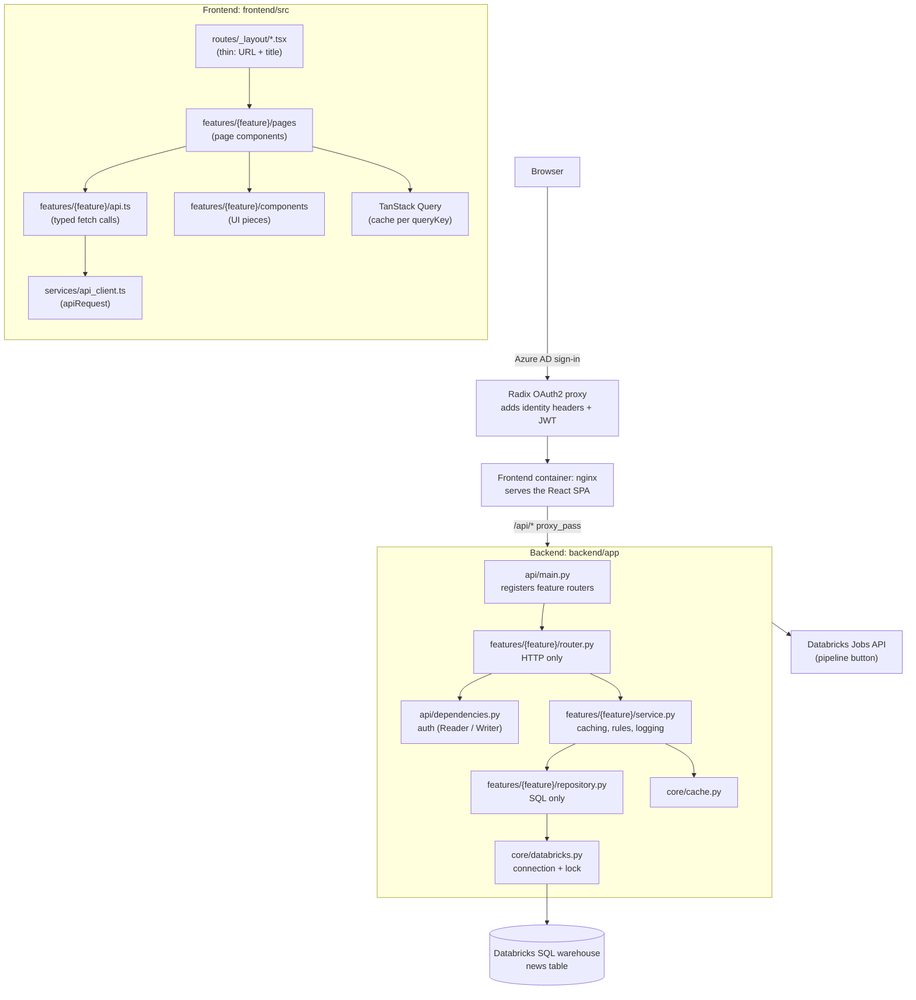
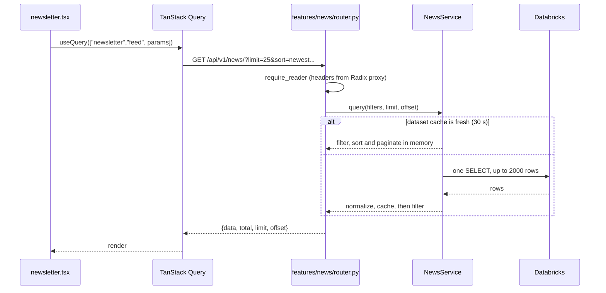
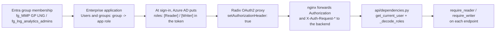
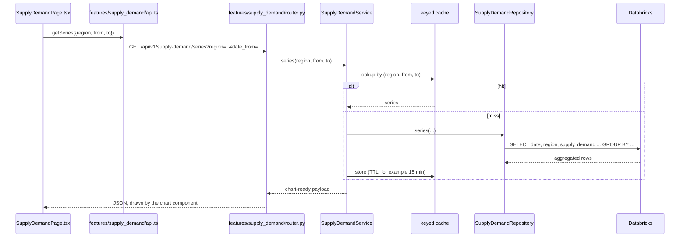

# LNG Trading App — News Analytics for LNG Markets

LNG news curation and sentiment analytics dashboard. Built with React + TypeScript (frontend) and FastAPI + Python (backend), backed by Databricks SQL and deployed on Radix.

## Prerequisites

- Docker Desktop (includes Docker Compose)
- Access to the Databricks workspace `gplng-plab-dbw` to retrieve the service principal credentials

## Running Locally

### 1. Configure environment variables

Copy the example env file at the repository root:

```bash
cp .env.example .env
```

Open `.env` and configure the Databricks connection:

```dotenv
# Databricks SQL Warehouse connection
DATABRICKS_SERVER_HOSTNAME=adb-XXXX.7.azuredatabricks.net
DATABRICKS_HTTP_PATH=/sql/1.0/warehouses/<warehouse-id>

# Service Principal auth
DATABRICKS_USE_SERVICE_PRINCIPAL=true
DATABRICKS_TENANT_ID=<tenant-id>
DATABRICKS_CLIENT_ID=<client-id>
DATABRICKS_CLIENT_SECRET=<client-secret>
DATABRICKS_WORKSPACE_RESOURCE_ID=<full-resource-id>
```

### 2. Start all services

From the repository root:

```bash
docker compose watch
```

This starts the following containers:

| Container | Exposed at |
|-----------|-----------|
| frontend (React + Vite + nginx) | http://localhost:5173 |
| backend (FastAPI) | http://localhost:8000 |
| db (PostgreSQL) | localhost:5432 |
| adminer (DB admin UI) | http://localhost:8080 |
| mailcatcher (local email) | http://localhost:1080 |

### 3. Open the app

http://localhost:5173

### Subsequent starts

Once the images are built, a plain `docker compose watch` will pick up file changes automatically via Docker watch mode (hot-reload for both frontend and backend).

To restart without watch mode:

```bash
docker compose up
```

### Tear down

```bash
docker compose down
```

To also remove the named volumes (database data):

```bash
docker compose down -v
```

## Local Development (without Docker)

You can stop individual Docker services and run them locally instead:

**Frontend:**
```bash
docker compose stop frontend
cd frontend
bun install
bun run dev
```

**Backend:**
```bash
docker compose stop backend
cd backend
fastapi dev app/main.py
```

Both use the same ports as their Docker counterparts, so everything keeps working seamlessly.

## Architecture



Each page is a feature: a folder under `backend/app/features/` (`news`, `pipeline_nominations`, `pipeline`) and one under `frontend/src/features/`. Each layer has one job:

| Layer | Responsibility |
|-------|----------------|
| `features/{feature}/router.py` | Parse request parameters, call the service, return the response. No business logic. |
| `features/{feature}/dependencies.py` | Builds the feature's service for dependency injection (one instance per process). |
| `features/{feature}/service.py` | Business rules, caching, normalization, logging. |
| `features/{feature}/repository.py` | SQL only. Returns raw rows. |
| `api/dependencies.py` | Authentication and authorization (Reader / Writer roles), shared by every feature. |
| `api/main.py` | Registers every feature router under `/api/v1`. |
| `core` | Configuration, the Databricks connection, caches. |

Calls only go one way: router, service, repository, core. Features do not import from each other. Anything two features need goes in `core` (backend) or in the shared folders `components`, `hooks` and `lib` (frontend).

There is no mock backend. The backend always talks to Databricks, so a valid Databricks configuration is required to run it.

### How a frontend page reaches a backend route

The two sets of routes are connected only by the URL path `/api/...`.

| Kind | Defined in | Example |
|------|------------|---------|
| Page route | `frontend/src/routes/_layout/*.tsx` (TanStack Router): URL and title only, the page lives in `frontend/src/features/*/pages/` | `/newsletter` |
| API route | `backend/app/features/*/router.py` (FastAPI) | `GET /api/v1/news/` |

The backend URL is assembled from three prefixes: `/api/v1` (`API_V1_STR` in `core/config.py`, used in `main.py`), `/news` (set in `api/main.py`), and the route decorator in the feature's router. The frontend repeats the full path by hand in `features/news/api.ts`, so a prefix change on the backend must be changed there too.

Requests are forwarded to the backend as follows:

| Environment | What forwards `/api` |
|-------------|----------------------|
| Radix (dev / prod) | nginx in the frontend container (`frontend/nginx-backend-not-found.conf`, `proxy_pass http://backend:8000`) |
| `bun run dev` | Vite dev proxy (`frontend/vite.config.ts`, target `http://localhost:8000`) |

The browser only talks to one origin, so no CORS is involved. nginx also forwards the `X-Auth-Request-*` and `Authorization` headers that the Radix OAuth2 proxy adds. `get_current_user` in `api/dependencies.py` reads them. When no proxy is in front of the backend (local development), it falls back to a dev user (`analyst@example.com`) with full access, so `/api/v1/utils/me` returns that user locally.

### Data flow: reading



Filtering, sorting and pagination run in memory against one cached snapshot, so Databricks is queried at most once per 30-second window.

### Data flow: writing (favourite, read, sentiment, classification)

1. The page calls `PATCH /news/{id}/favourite` (or `/read`, `/sentiment`, `/classification`). This needs the Writer role.
2. `NewsService.begin_update` stores an optimistic override and the route returns it at once.
3. A background task runs `NewsService.commit_update`, which sends the UPDATE to Databricks. On success it patches the cached dataset and clears the override. On failure it logs the error (with the user's email), clears the override and invalidates the cache.
4. The page invalidates its query and refetches.

Write failures are only logged. They are not shown in the UI.

### Other endpoints

- `GET /news/facets`: distinct categories and regions for the filter dropdowns.
- `GET /pipeline-nominations/filters` and `GET /pipeline-nominations/overview`: data for the Pipeline Nominations page (see below).
- `POST /news/email-summary`: builds an email from the favourited articles (`features/news/email_summary.py`) and sends it in the background. Needs the Writer role and the Atlas email settings.
- `GET /news/pipeline/last-run` and `POST /news/pipeline/trigger`: read the status of, and start, the Databricks ingestion job through the Jobs REST API (`features/pipeline/jobs.py`). Trigger returns 503 when Databricks is not configured.

## Pipeline Nominations page

The page at `/pipeline_nominations` reproduces the "Platts US Daily Pipeline Nominations (Monthly)" report. It is a feature folder on each side, as described under "Adding a New Page".

| Part | File |
|------|------|
| Route (HTTP only) | `backend/app/features/pipeline_nominations/router.py` |
| Service (cache, daily series, monthly matrix, month-on-month %) | `backend/app/features/pipeline_nominations/service.py` |
| Repository (one SQL query) | `backend/app/features/pipeline_nominations/repository.py` |
| Response models | `backend/app/features/pipeline_nominations/schemas.py` |
| Service provider | `backend/app/features/pipeline_nominations/dependencies.py` |
| API calls and types | `frontend/src/features/pipeline_nominations/api.ts` |
| Page | `frontend/src/features/pipeline_nominations/pages/PipelineNominationsPage.tsx` |
| Route (URL and title) | `frontend/src/routes/_layout/pipeline_nominations.tsx` |
| Components | `frontend/src/features/pipeline_nominations/components/` (`PipelineFilter`, `FlowChart`, `MonthlyMatrix`) |

**Data.** The source is the table in `PIPELINE_NOMINATIONS_TABLE` (`ms_vulcan_gplng_plab.fundamentals_silver.platts_facility_level_flow_data`). The service account used by the backend needs `SELECT` on it. The repository runs one query that sums `Vol_BCF` per facility (`name`), pipeline (`pipelineName`, trimmed) and day over the last 13 months. The service caches that result for 15 minutes and derives everything else from it in memory.

**Endpoints** (Reader role):

| Endpoint | Returns |
|----------|---------|
| `GET /api/v1/pipeline-nominations/filters` | Facilities with their pipelines, and the latest data date |
| `GET /api/v1/pipeline-nominations/overview?selected=Facility::Pipeline\|Facility::Pipeline` | The 14-day and 180-day daily series per facility, and the monthly matrix. An empty `selected` means everything. |

**Behaviour to know about**

- The 14 and 180 day windows end at the latest date in the data, not at today's date, so the charts are never empty when the feed is a few days behind.
- Month columns come from the whole dataset, so they stay the same while filtering.
- The % columns are month-on-month changes. They are blank when the previous month is missing or zero.
- The latest month is marked with `*` and shown in italics when the data stops before month end, because its % change compares a partial month with a full one.
- The filter works like a Power BI slicer: ticking a facility selects all of its pipelines, expanding it lets you pick individual pipelines, and nothing ticked means everything.

## Authentication and Access Control

Sign-in is handled outside the app by the Radix OAuth2 proxy and Azure AD. Read and write access comes from Azure AD app roles on the app's Enterprise application. There is no user table in this app, and nothing is synced into a database.



### Current role assignments

Configured in the Azure portal, Enterprise application `lng-trading-app`, Users and groups:

| Group | Role | Effect in the app |
|-------|------|-------------------|
| `fg_MMP GP LNG` | Reader | Can sign in and read |
| `fg_lng_analytics_admins` | Writer | Can sign in, read and write |

### How access is decided

Every request is checked in `get_current_user` in `backend/app/api/dependencies.py`. The backend is stateless and works out the user from the headers on each request.

| Rule | Source |
|------|--------|
| Sign-in allowed | Enterprise application: "Assignment required" plus the users and groups assigned to it |
| Email domain | Must end with `ALLOWED_EMAIL_DOMAIN` (default `equinor.com`), otherwise 403 |
| Read | Any signed-in user who passes the domain check. The `Reader` role is not checked in code; it only gates sign-in. |
| Write | The token's `roles` claim contains `Writer` (any role value containing "writ" or "admin" also counts) |
| Break-glass writer | The email equal to `FIRST_SUPERUSER`, set in `radixconfig.yaml` |

Which endpoint needs what:

| Requirement | Endpoints |
|-------------|-----------|
| Reader (signed in) | `GET /news/`, `GET /news/facets`, `GET /news/pipeline/last-run`, `GET /pipeline-nominations/filters`, `GET /pipeline-nominations/overview` |
| Writer | The four `PATCH /news/{id}/...` routes, `POST /news/email-summary`, `POST /news/pipeline/trigger` |
| Signed-in user only | `GET /utils/me` |
| None | `GET /utils/health-check` |

The read check is applied to a whole router (`APIRouter(dependencies=[Depends(require_reader)])`). Write routes take a `user: WriterUser` parameter, which runs the write check and passes the user to the function. The user's email is written to the log when an article is changed. It is not stored in the database.

### How and where to add or change roles

Access changes are made in Azure, not in this repo. You need to be an owner of the Enterprise application, or have an Entra role such as Application Administrator.

**Give or remove access for a person**

1. Add the person to the right Entra group: `fg_MMP GP LNG` for read access, `fg_lng_analytics_admins` for read and write. Remove them from the group to take access away.
2. Ask them to sign out and in again (`/oauth2/sign_out`). Roles are put into the token at sign-in, so the change is not visible until they do.

**Assign a new group or user to the app, or change an existing assignment**

1. Open the Azure portal, then Microsoft Entra ID, Enterprise applications, `lng-trading-app`, Users and groups.
2. To add one, select **Add user/group**, pick the user or group, select the role (`Reader` or `Writer`) and assign.
3. To change a role, select the row and choose **Edit assignment**. To remove access, choose **Remove assignment**.

**Check the result**

Open `/api/v1/utils/me` on the deployed app. It returns your email, `roles`, `can_read` and `can_write`.

**Define a new role** (for example `Admin`)

1. In the Azure portal, open the App registration for this app (the client ID is the `clientId` under `oauth2` in `radixconfig.yaml`), then App roles, Create app role. Set the display name, the **value** (this is what appears in the token), and allowed member types "Users/Groups".
2. Assign the new role to a group in the Enterprise application as described above.
3. Update the backend: add the role value in `api/dependencies.py` (next to `WRITER_ROLE` and `READER_ROLE`), include it in `get_current_user` or `_is_writer`, and add a `require_<role>` dependency for endpoints that need it.

**Other settings**

- `FIRST_SUPERUSER` (a variable in `radixconfig.yaml`): this email always gets write access, regardless of roles.
- `ALLOWED_EMAIL_DOMAIN` (`backend/app/core/config.py`): the allowed email domain. Set it to an empty string to allow any signed-in email.
- Enterprise application, Properties, "Assignment required": when on, only assigned users and groups can sign in at all.

### Limits and caveats

- **Nested groups:** Azure does not pass an app role down to nested groups. Only direct members of an assigned group get the role.
- **Locally:** there is no proxy, so every request is the dev user `analyst@example.com` with full access. Roles cannot be tested locally without a proxy in front.
- **Fails open without the proxy:** if a request reaches the backend with no email header, it gets the full-access dev user. This is intended locally. In Radix, keep the backend component without a public port so requests must pass through the proxy.
- **Token is not verified in the backend:** `_decode_roles` reads the roles from the token without checking its signature, because it trusts the proxy to have validated the token.
- **UI:** the frontend does not hide write controls for read-only users. They get a 403 from the backend when they try to write.
- **Unused template code:** the Postgres user table, the Admin components and the `Admin` sidebar item are leftovers from the template. They are not connected to access control.

## Adding a New Page

Each page is its own feature: a folder under `backend/app/features/<name>/` and one under `frontend/src/features/<name>/`. Features share only auth, the Databricks connection, the cache and the shared UI folders, and they do not import from each other. `pipeline_nominations` is a complete, small example to copy from.

The example below is a supply and demand charts page.

### Where each file goes

```
backend/app/features/supply_demand/
  __init__.py
  router.py              HTTP endpoints
  service.py             caching and shaping the data
  repository.py          SQL only
  schemas.py             response models
  dependencies.py        builds the service
backend/app/api/main.py  register the router

frontend/src/features/supply_demand/
  api.ts                 typed calls to the backend
  utils.ts               formatting and data-shaping helpers
  components/            chart and filter components
  pages/SupplyDemandPage.tsx    the page
frontend/src/routes/_layout/supply_demand.tsx   route: URL and title only
frontend/src/components/Sidebar/AppSidebar.tsx  add a menu entry
```

Keep a feature flat until it grows: add `hooks/` or more subfolders only when a folder holds several files.

### Data flow for the new page



### Backend steps

1. **Repository** (`features/supply_demand/repository.py`): SQL only, using `?` placeholders.
   ```python
   class SupplyDemandRepository:
       def series(self, region: str | None, date_from: str, date_to: str) -> list[dict]:
           query = f"""
               SELECT date, region, SUM(supply) AS supply, SUM(demand) AS demand
               FROM {settings.SUPPLY_DEMAND_TABLE}
               WHERE (? IS NULL OR region = ?) AND date BETWEEN ? AND ?
               GROUP BY date, region ORDER BY date
           """
           return fetch_all(query, [region, region, date_from, date_to])
   ```
   Add `SUPPLY_DEMAND_TABLE` to `core/config.py`, and to the variables in `radixconfig.yaml`.
2. **Service**: holds the repository, caches results and returns chart-ready series. `TTLCache` in `core/cache.py` holds a single value, so parametrised data needs a keyed cache. Add a `KeyedTTLCache` next to it.
3. **Provider** (`features/supply_demand/dependencies.py`), the same pattern as news:
   ```python
   @lru_cache
   def get_supply_demand_service() -> SupplyDemandService:
       return SupplyDemandService(SupplyDemandRepository())

   SupplyDemandServiceDep = Annotated[SupplyDemandService, Depends(get_supply_demand_service)]
   ```
4. **Router** (`features/supply_demand/router.py`), with the Reader role applied to the whole router:
   ```python
   router = APIRouter(dependencies=[Depends(require_reader)])

   @router.get("/series", response_model=SeriesResponse)
   def series(service: SupplyDemandServiceDep, date_from: str, date_to: str, region: str | None = None):
       return service.series(region, date_from, date_to)
   ```
   For write endpoints, add a `WriterUser` parameter (from `api/dependencies.py`).
5. **Register it** in `api/main.py`:
   ```python
   from app.features.supply_demand.router import router as supply_demand_router

   api_router.include_router(supply_demand_router, prefix="/supply-demand", tags=["supply-demand"])
   ```
   The tag is required, because `custom_generate_unique_id` in `main.py` reads `route.tags[0]`.

### Frontend steps

1. **API module** (`features/supply_demand/api.ts`):
   ```ts
   export const getSeries = (p: { region?: string; dateFrom: string; dateTo: string }) =>
     apiRequest<SeriesResponse>("/api/v1/supply-demand/series", {
       query: { date_from: p.dateFrom, date_to: p.dateTo, ...(p.region ? { region: p.region } : {}) },
     })
   ```
   All `query` values must be strings.
2. **Page** (`features/supply_demand/pages/SupplyDemandPage.tsx`): a plain component that fetches with `useQuery` and renders the feature's components.
   ```tsx
   export function SupplyDemandPage() {
     const q = useQuery({
       queryKey: ["supply_demand", "series", params],
       queryFn: () => getSeries(params),
       staleTime: 5 * 60_000,
     })
     // render the filters and <SupplyDemandChart data={q.data} />
   }
   ```
3. **Route** (`routes/_layout/supply_demand.tsx`): the file path decides the URL, so this page is `/supply_demand`. Keep the file thin.
   ```tsx
   export const Route = createFileRoute("/_layout/supply_demand")({
     component: SupplyDemandPage,
     head: () => ({ meta: [{ title: "Supply & Demand - LNG Trading App" }] }),
   })
   ```
4. **Sidebar entry**: add an item to `baseItems` in `components/Sidebar/AppSidebar.tsx`, for example `{ icon: LineChart, title: "Supply & Demand", path: "/supply_demand" }`.
5. **Charts**: `recharts` is already a dependency. See `features/pipeline_nominations/components/FlowChart.tsx` for a line chart that follows the app theme.
6. **Route tree**: `frontend/src/routeTree.gen.ts` is regenerated by the Vite router plugin when you run the dev server or a build. Do not edit it by hand. If the dev server is running when you create a route file, check that it did not append placeholder code to it.

### What you do not need to change

- **nginx and the Vite dev proxy**: every `/api/...` path is already forwarded.
- **Auth**: the `_layout` shell and the router-level `require_reader` cover it.
- **Query client setup and the 401/403 redirect**: both are global in `main.tsx`.

### Things to watch

- **One Databricks connection**: `core/databricks.py` holds one connection behind one lock, so a slow query on one page blocks the others. Cache results, and move to a small connection pool when several heavy pages exist.
- **Aggregate in SQL**: do not copy the news pattern of loading rows and filtering in Python for time series. Return only the series the chart needs.
- **Per-process caches**: caches are not shared between workers or replicas, so each keeps its own copy.
- **Tests**: a service can be tested without a database by overriding its provider, for example `app.dependency_overrides[get_supply_demand_service]`.

## Project Structure

```
lng-trading-app/
├── backend/                    # FastAPI application
│   ├── app/
│   │   ├── main.py             # Entry point, middleware, router registration
│   │   ├── api/
│   │   │   ├── main.py          # Registers every feature router under /api/v1
│   │   │   ├── dependencies.py  # Authentication and authorization (Reader / Writer roles)
│   │   │   └── routes/utils.py  # Health check and current user
│   │   ├── features/           # One folder per feature (page)
│   │   │   ├── news/
│   │   │   │   ├── router.py             # HTTP endpoints
│   │   │   │   ├── service.py            # Dataset cache, optimistic updates, background writes
│   │   │   │   ├── repository.py         # SQL access to the news table
│   │   │   │   ├── schemas.py            # Request / response models
│   │   │   │   ├── dependencies.py       # Builds the service
│   │   │   │   ├── query.py              # Filtering, sorting, pagination
│   │   │   │   ├── normalization.py      # Tag and region normalization
│   │   │   │   └── email_summary.py      # Summary email builder
│   │   │   ├── pipeline_nominations/     # router, service, repository, schemas, dependencies
│   │   │   └── pipeline/                 # router.py + jobs.py (Databricks job trigger / status)
│   │   └── core/
│   │       ├── config.py        # All configuration (loaded from .env)
│   │       ├── cache.py         # TTLCache and PendingOverrides
│   │       ├── databricks.py    # Databricks connection manager
│   │       └── security.py     # JWT / password hashing
│   ├── tests/                  # Pytest test suite
│   └── Dockerfile
├── frontend/                   # React + TypeScript application
│   ├── src/
│   │   ├── main.tsx            # App entry point
│   │   ├── routes/             # TanStack Router file-based routes: thin files with URL and title only
│   │   │   └── _layout/        # newsletter, news_summary, news_summary_condensed, pipeline_nominations
│   │   ├── features/           # One folder per feature (page)
│   │   │   ├── news/
│   │   │   │   ├── pages/       # NewsletterPage, NewsSummaryPage, NewsSummaryCondensedPage
│   │   │   │   ├── components/  # Article panels, layouts, pipeline and email buttons
│   │   │   │   ├── hooks/       # useNewsLayout, useHiddenArticles
│   │   │   │   ├── api.ts       # API functions (getNews, patch*)
│   │   │   │   ├── utils.ts     # Helpers (formatTime, cleanTagValue, etc.)
│   │   │   │   └── layout.ts    # Layout and grouping logic
│   │   │   └── pipeline_nominations/   # pages, components (PipelineFilter, FlowChart, MonthlyMatrix), api.ts, utils.ts
│   │   ├── components/         # Shared UI: ui/ (shadcn), Common/, Sidebar/
│   │   ├── hooks/              # Shared hooks (useAuth, useDateFilter, useEquinorFont, ...)
│   │   ├── services/api_client.ts   # fetch wrapper used by every feature's api.ts
│   │   └── lib/utils.ts        # Tailwind merge + formatHtmlText
│   ├── nginx.conf              # Production nginx config
│   └── Dockerfile
├── compose.yml                 # Base Docker Compose config
├── compose.override.yml        # Local dev overrides (ports, hot-reload, mailcatcher)
├── compose.traefik.yml         # Traefik proxy config for subdomain routing
├── radixconfig.yaml            # Radix (Equinor PaaS) deployment config
└── .env                        # ⚠ Local secrets — gitignored, never commit
```

## Environment Variables Reference

### Required locally

| Variable | Description |
|----------|-------------|
| `DATABRICKS_SERVER_HOSTNAME` | Databricks workspace hostname |
| `DATABRICKS_HTTP_PATH` | SQL Warehouse HTTP path |
| `DATABRICKS_USE_SERVICE_PRINCIPAL` | Set to `true` |
| `DATABRICKS_TENANT_ID` | Azure AD tenant ID |
| `DATABRICKS_CLIENT_ID` | Service principal client ID |
| `DATABRICKS_CLIENT_SECRET` | Service principal client secret |
| `DATABRICKS_WORKSPACE_RESOURCE_ID` | Full Azure resource ID for the workspace |

### Optional / pre-filled

| Variable | Default | Description |
|----------|---------|-------------|
| `NEWS_TABLE` | `ms_vulcan_gplng_plab.trader_news_app.platts_lng_top_news` | Unity Catalog table name |
| `PIPELINE_NOMINATIONS_TABLE` | `ms_vulcan_gplng_plab.fundamentals_silver.platts_facility_level_flow_data` | Platts facility-level daily flow table |
| `SECRET_KEY` | random | JWT signing key |
| `BACKEND_CORS_ORIGINS` | `http://localhost:5173` | Allowed CORS origins |
| `FIRST_SUPERUSER` | `admin@example.com` | Default admin user email |
| `FIRST_SUPERUSER_PASSWORD` | `changethis` | Default admin password |

### Not needed locally

| Variable | Why not needed |
|----------|---------------|
| `SENTRY_DSN` | Error tracking — only for staging/production |
| `SMTP_HOST` / `SMTP_USER` / `SMTP_PASSWORD` | Mailcatcher handles email locally |

## Deployment

The app deploys on [Radix](https://www.radix.equinor.com/) (Equinor's PaaS). Configuration is in `radixconfig.yaml`.

| Environment | Branch | Frontend |
|-------------|--------|----------|
| dev | `main` | Auth bypassed (`VITE_BYPASS_AUTH=true`) |
| prod | `release` | Full auth enabled |

The backend reads its Databricks credentials from Radix secrets.

## Tech Stack

- **Frontend:** React 19, TypeScript, Vite, TanStack Router, TanStack React Query, Tailwind CSS v4, shadcn/ui
- **Backend:** FastAPI, Python 3.12+, Pydantic, Databricks SQL Connector
- **Database:** PostgreSQL (user accounts), Databricks Unity Catalog (news data)
- **Infrastructure:** Docker Compose (local), Radix (deployment), Traefik (proxy)
- **Testing:** Pytest (backend), Playwright (E2E)
